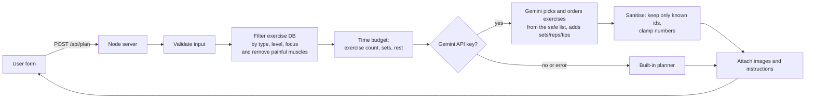

# FitGuide AI – Fitness Assistance Website

A web app that builds a personalised workout using the **Google Gemini API**. The user picks:

1. **Training type**: Powerlifting, Bodybuilding, Calisthenics, Cardio / Fat loss, Olympic weightlifting, Flexibility / Mobility
2. **Time available**: 15–120 minutes
3. **Fitness level** and **body part to train** (full body, upper, lower, push, pull, arms, core)
4. **Pain areas**: neck, shoulder, traps, chest, elbow, hands/wrists, upper back, lower back, hips, knees, ankles
5. Optional notes (e.g. "home workout, dumbbells only")

The app returns a warm-up, main exercises with **images, sets, reps, rest and estimated time**, gentle relief stretches for the painful areas, a cool-down, and step-by-step instructions for each exercise.

## Tech stack

| Part | Technology |
|------|------------|
| Backend | Node.js 22+ (built-in `http`, no npm dependencies) |
| AI | Gemini REST API (`generateContent` with a JSON response schema) |
| Frontend | HTML, CSS, vanilla JavaScript |
| Exercise data | [free-exercise-db](https://github.com/yuhonas/free-exercise-db) (873 exercises with images, public domain) |
| Tests | `node:test` |

## How it works



Gemini can only choose from a pre-filtered list of safe exercise ids, so it cannot invent an exercise or pick one that loads a painful muscle. The server checks every id it returns and attaches the real image and instructions from the database. If Gemini fails or there is no API key, a built-in planner produces a plan so the demo still works.

## Setup

1. Install [Node.js 22 or newer](https://nodejs.org).
2. Get a free Gemini API key from [Google AI Studio](https://aistudio.google.com/apikey).
3. In the project folder, copy the env file and add your key:

   ```powershell
   Copy-Item .env.example .env
   # then edit .env and set GEMINI_API_KEY=your_key
   ```

4. Start the server:

   ```powershell
   npm start
   ```

5. Open <http://localhost:3000>.

`GEMINI_MODEL` defaults to `gemini-flash-latest`. You can set any model that supports `generateContent`, such as `gemini-2.5-flash`.

Run the tests with `npm test`.

## Deploy to Vercel

Vercel detects `server.js` and runs it as a Node.js function. Files in `public/` are served from Vercel's CDN, and `vercel.json` adds the same security headers to them.

```powershell
npx vercel@latest deploy --prod
# Optional: enable Gemini, then redeploy so the key is picked up
npx vercel@latest env add GEMINI_API_KEY production
npx vercel@latest deploy --prod
```

Without `GEMINI_API_KEY` the site works in offline mode using the built-in planner.

## Project structure

```text
FitGuide-AI/
├── server.js            HTTP server, API routes, static files, rate limiting
├── vercel.json          Security headers for static files on Vercel
├── lib/
│   ├── catalog.js       Exercise data, workout types, focus and pain-area mappings
│   └── planner.js       Validation, filtering, time budget, Gemini call, fallback plan
├── data/exercises.json  Exercise database
├── public/              Frontend (index.html, style.css, app.js)
└── test/                Unit tests
```

## API

`GET /api/options` returns the form choices and whether AI is enabled.

`POST /api/plan` with JSON body:

```json
{
  "workoutType": "calisthenics",
  "duration": 45,
  "level": "beginner",
  "focus": "upper",
  "painAreas": ["shoulder"],
  "notes": "no pull-up bar"
}
```

## Security notes

- The API key stays on the server and is read from `.env` (git-ignored).
- All input is validated against fixed lists; the request body is capped at 10 KB.
- Each IP is limited to 15 plan requests per minute to protect the Gemini quota. On Vercel the client IP comes from the `x-real-ip` header set by the platform.
- Malformed URLs return 400 instead of crashing the server.
- Gemini output is treated as untrusted. Unknown ids are dropped and numbers are clamped.
- The frontend builds the DOM with `textContent` and a strict Content-Security-Policy, so AI text cannot inject HTML.

## Disclaimer

This app gives general fitness guidance and is not medical advice. Anyone with ongoing pain should see a doctor or physiotherapist.
